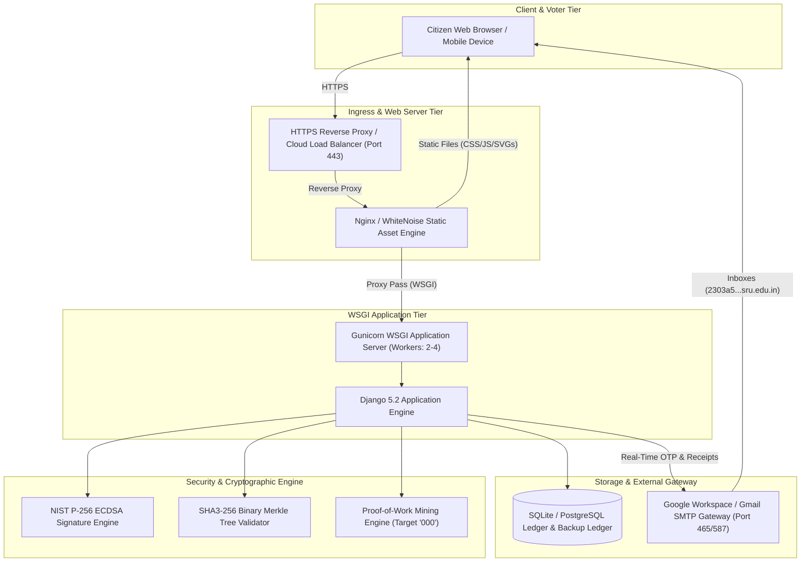

# 🚀 Complete Deployment Guide
## Decentralized E-Voting System using Blockchain & Cryptography

### SR University (SRU) • School of Computer Science & Engineering
**Project Team**: Supreeth, Abhishek, Awez ali, Charith  
**Stack**: Python 3.11 • Django 5.2 • Gunicorn • WhiteNoise • PyCryptodome (NIST P-256 ECDSA, SHA3-256)

---

## 📋 Table of Contents
1. [Deployment Architecture Overview](#1-deployment-architecture-overview)
2. [Option 1: Free Cloud Deployment on Render (Recommended)](#option-1-free-cloud-deployment-on-render-recommended)
3. [Option 2: 1-Click Cloud Deployment on Railway](#option-2-1-click-cloud-deployment-on-railway)
4. [Option 3: Local Campus Network / College Wi-Fi Demo (For Evaluators & Viva)](#option-3-local-campus-network--college-wi-fi-demo-for-evaluators--viva)
5. [Option 4: Production Linux VPS (AWS EC2 / DigitalOcean / Ubuntu)](#option-4-production-linux-vps-aws-ec2--digitalocean--ubuntu)
6. [Option 5: Containerized Deployment (Docker & Docker Compose)](#option-5-containerized-deployment-docker--docker-compose)
7. [Environment Variables Reference](#7-environment-variables-reference)
8. [Post-Deployment Verification Checklist](#8-post-deployment-verification-checklist)

---

## 1. Deployment Architecture Overview



---

## Option 1: Free Cloud Deployment on Render (Recommended)

Render provides free hosting with automatic HTTPS, continuous deployment from GitHub, and seamless environment variable support.

### Step 1: Push Project to GitHub
1. Create a new repository on [GitHub](https://github.com/) (e.g., `sru-blockchain-voting`).
2. In your terminal inside the project root:
   ```bash
   git init
   git add .
   git commit -m "SRU Blockchain E-Voting System: Production Ready"
   git branch -M main
   git remote add origin https://github.com/<YOUR-USERNAME>/sru-blockchain-voting.git
   git push -u origin main
   ```

### Step 2: Create Web Service on Render
1. Sign in to [Render Dashboard](https://dashboard.render.com/).
2. Click **New +** → **Web Service**.
3. Select **Build and deploy from a Git repository** and connect your repository.
4. Configure the service settings:
   - **Name**: `sru-blockchain-voting`
   - **Region**: `Singapore` or nearest
   - **Branch**: `main`
   - **Runtime**: `Python 3`
   - **Build Command**:
     ```bash
     pip install -r requirements.txt && python manage.py collectstatic --noinput && python manage.py migrate
     ```
   - **Start Command**:
     ```bash
     gunicorn Election.wsgi:application --bind 0.0.0.0:$PORT --workers 2 --timeout 120
     ```

### Step 3: Configure Environment Variables
Under the **Environment Variables** tab, add:
| Key | Value | Description |
| :--- | :--- | :--- |
| `DJANGO_DEBUG` | `False` | Disables debug mode in production |
| `DJANGO_SECRET_KEY` | *(Click "Generate")* | Cryptographic Django session key |
| `ALLOWED_HOSTS` | `*` | Allows Render subdomains |
| `EMAIL_HOST` | `smtp.gmail.com` | SMTP Server |
| `EMAIL_PORT` | `465` | SSL Port |
| `EMAIL_ADDRESS` | `charithch2006@gmail.com` | Your verified sender email |
| `EMAIL_PASSWORD` | `moaw ybgs kqnj yomq` | 16-character Google App Password |
| `TRANSACTIONS_PER_BLOCK` | `1` | Blockchain block size |
| `PUZZLE` | `000` | Proof-of-work difficulty |

5. Click **Create Web Service**. Render will build and deploy the app at:
   `https://sru-blockchain-voting.onrender.com`

---

## Option 2: 1-Click Cloud Deployment on Railway

Railway reads the pre-configured [Procfile](file:///c:/Users/chari/Downloads/voting-system-using-block-chain-master/Procfile) and [requirements.txt](file:///c:/Users/chari/Downloads/voting-system-using-block-chain-master/requirements.txt) automatically:

1. Sign in to [Railway.app](https://railway.app/).
2. Click **New Project** → **Deploy from GitHub repo**.
3. Choose your repository.
4. Go to **Variables** and add:
   - `EMAIL_ADDRESS`: `charithch2006@gmail.com`
   - `EMAIL_PASSWORD`: `moaw ybgs kqnj yomq`
   - `DJANGO_DEBUG`: `False`
5. Go to **Settings** → **Networking** → Click **Generate Domain**.
6. Your blockchain portal is live on HTTPS instantly!

---

## Option 3: Local Campus Network / College Wi-Fi Demo (For Evaluators & Viva)

During project evaluation, you can host the portal on your laptop and let external examiners and professors open it on their own smartphones/laptops over the college Wi-Fi.

### Step 1: Find Your Laptop's Local IP Address
In PowerShell:
```powershell
ipconfig
```
Look for **IPv4 Address** under `Wireless LAN adapter Wi-Fi` (e.g., `192.168.1.45` or `10.10.x.x`).

### Step 2: Open Windows Firewall Port 8000
Run PowerShell as Administrator:
```powershell
New-NetFirewallRule -DisplayName "SRU Blockchain Voting" -Direction Inbound -LocalPort 8000 -Protocol TCP -Action Allow
```

### Step 3: Start Server on `0.0.0.0:8000`
Run:
```powershell
py manage.py runserver 0.0.0.0:8000
```

### Step 4: Access from Other Phones/Laptops
Tell the evaluator to connect to the same Wi-Fi and open their phone browser:
```text
http://192.168.1.45:8000
```
*(Replace `192.168.1.45` with your laptop's actual IPv4 address)*

---

## Option 4: Production Linux VPS (AWS EC2 / DigitalOcean / Ubuntu)

For dedicated production hosting with custom domain and full systemd process supervision:

### Step 1: Server Setup (Ubuntu 22.04 / 24.04 LTS)
```bash
sudo apt update && sudo apt upgrade -y
sudo apt install -y python3-pip python3-venv nginx git certbot python3-certbot-nginx
```

### Step 2: Clone & Configure Repository
```bash
cd /var/www
sudo git clone https://github.com/<YOUR-USERNAME>/sru-blockchain-voting.git voting
cd voting
sudo chown -R $USER:$USER /var/www/voting

# Create virtual environment
python3 -m venv venv
source venv/bin/activate
pip install --upgrade pip
pip install -r requirements.txt

# Setup production environment
cp .env.example .env
nano .env  # Add your EMAIL_ADDRESS & EMAIL_PASSWORD
```

### Step 3: Run Database Migrations & Collect Static Assets
```bash
python manage.py migrate
python manage.py collectstatic --noinput
```

### Step 4: Setup Systemd Service
Create `/etc/systemd/system/voting.service`:
```ini
[Unit]
Description=Gunicorn instance for SRU Blockchain E-Voting System
After=network.target

[Service]
User=ubuntu
Group=www-data
WorkingDirectory=/var/www/voting
Environment="PATH=/var/www/voting/venv/bin"
ExecStart=/var/www/voting/venv/bin/gunicorn --workers 3 --bind 127.0.0.1:8000 --timeout 120 Election.wsgi:application

[Install]
WantedBy=multi-user.target
```

Enable and start the service:
```bash
sudo systemctl daemon-reload
sudo systemctl start voting
sudo systemctl enable voting
sudo systemctl status voting
```

### Step 5: Configure Nginx Reverse Proxy
Create `/etc/nginx/sites-available/voting`:
```nginx
server {
    server_name voting.yourdomain.com;

    location /static/ {
        alias /var/www/voting/staticfiles/;
        expires 30d;
        add_header Cache-Control "public, max-age=2592000";
    }

    location / {
        proxy_pass http://127.0.0.1:8000;
        proxy_set_header Host $host;
        proxy_set_header X-Real-IP $remote_addr;
        proxy_set_header X-Forwarded-For $proxy_add_x_forwarded_for;
        proxy_set_header X-Forwarded-Proto $scheme;
    }
}
```

Enable Nginx site:
```bash
sudo ln -s /etc/nginx/sites-available/voting /etc/nginx/sites-enabled/
sudo nginx -t
sudo systemctl restart nginx
```

### Step 6: Enable Free SSL (Let's Encrypt)
```bash
sudo certbot --nginx -d voting.yourdomain.com
```

---

## Option 5: Containerized Deployment (Docker & Docker Compose)

Deploy anywhere in 1 command using the pre-configured [Dockerfile](file:///c:/Users/chari/Downloads/voting-system-using-block-chain-master/Dockerfile) and [docker-compose.yml](file:///c:/Users/chari/Downloads/voting-system-using-block-chain-master/docker-compose.yml):

### 1. Build & Run
```bash
docker-compose up --build -d
```

### 2. View Logs
```bash
docker-compose logs -f web
```

### 3. Stop Container
```bash
docker-compose down
```

---

## 7. Environment Variables Reference

| Variable | Recommended Production Value | Description |
| :--- | :--- | :--- |
| `DJANGO_SECRET_KEY` | *(64-char random string)* | Cryptographic security salt for Django sessions |
| `DJANGO_DEBUG` | `False` | Disables debug traceback exposure |
| `ALLOWED_HOSTS` | `*` or `voting.sru.edu.in,onrender.com` | Allowed incoming HTTP Host headers |
| `CSRF_TRUSTED_ORIGINS` | `https://voting.sru.edu.in` | Trusted origins for HTTPS form submission |
| `EMAIL_HOST` | `smtp.gmail.com` | Outgoing SMTP server address |
| `EMAIL_PORT` | `465` (SSL) or `587` (TLS) | Outgoing SMTP network port |
| `EMAIL_ADDRESS` | `charithch2006@gmail.com` | Authenticated sender email |
| `EMAIL_PASSWORD` | `moaw ybgs kqnj yomq` | Google 16-character App Password |
| `TRANSACTIONS_PER_BLOCK` | `1` | Number of ballots required before block sealing |
| `PUZZLE` | `000` | Proof-of-Work leading zero difficulty target |

---

## 8. Post-Deployment Verification Checklist

After deploying to any platform, run through this 5-point verification:

1. **Homepage & Electoral Roll**:
   - Open root URL.
   - Verify that all 4 team members (Supreeth, Abhishek, Awez ali, Charith) appear in the electoral roll chips.
2. **Real-Time OTP Delivery**:
   - Click a team member's chip and click **Send OTP**.
   - Check that the 6-digit OTP code arrives in their `@sru.edu.in` university email within 3–5 seconds.
3. **Cryptographic Signing & Ballot Cast**:
   - Enter OTP, select a candidate, auto-fill/paste ECDSA private key, and click **Yes, Cast Vote**.
   - Verify that the on-screen receipt displays the SHA3-256 ballot hash and ECDSA signature.
   - Verify that the **Official Vote Confirmation Receipt** arrives in the voter's university inbox.
4. **Proof-of-Work Block Mining**:
   - Navigate to `/mine-block` and click **Start Mining Block**.
   - Verify that the nonce puzzle is solved and the block hash begins with `000`.
5. **Merkle Proof & Tamper Audit**:
   - Navigate to `/blockchain` and open Block #1.
   - Click **Simulate Tamper / Cyberattack** to demonstrate live cryptographic tampering detection (Merkle root mismatch).
   - Click **Self-Healing Consensus Recovery** to demonstrate automated state recovery from the immutable ledger.

