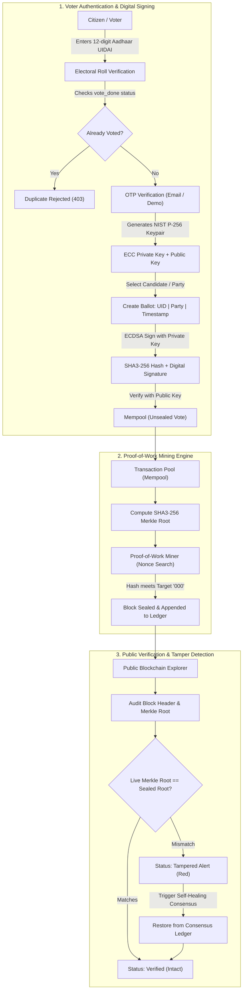

# 🗳️ Decentralized E-Voting System using Blockchain & Cryptography

[](https://www.python.org/)
[](https://www.djangoproject.com/)
[](https://pycryptodome.readthedocs.io/)
[-purple)](https://en.wikipedia.org/wiki/Proof_of_work)
[](home/tests.py)

An end-to-end decentralized, tamper-evident Electronic Voting System built with **Django**, **ECDSA (Elliptic Curve Digital Signatures)**, **SHA3-256 Merkle Trees**, and a **Proof-of-Work (PoW) Blockchain Ledger**.

---

## 📌 Executive Summary

Traditional centralized electronic voting systems suffer from single points of failure, lack of public verifiability, and vulnerability to insider database manipulation. 

This project solves these fundamental flaws by implementing:
1. **Cryptographic Identity & Digital Signatures**: Every voter receives a NIST P-256 ECC key pair. Ballots are digitally signed using ECDSA with SHA3-256 (FIPS 186-3 standard), guaranteeing non-repudiation and authenticity.
2. **Proof-of-Work Blockchain Consensus**: Cast votes enter a mempool and are sealed into chronologically linked blocks via Proof-of-Work (SHA3-256 cryptographic puzzle).
3. **Merkle Tree Auditing**: Every block summarizes its constituent votes into a cryptographic Merkle Root. If an attacker modifies even a single bit of a vote in the database, the Merkle root changes immediately, triggering a tamper alert.
4. **Self-Healing Distributed Consensus**: Incorporates automated consensus ledger synchronization (`sync_block`) allowing corrupted nodes to restore their state from consensus history.
5. **Seamless Demo Mode & Quick Test Suite**: Ready for live viva, academic presentations, and evaluations out-of-the-box without requiring complex email/SMTP configurations.

---

## 🏗️ System Architecture & Workflow



---

## 🔑 Key Cryptographic & Blockchain Specifications

| Feature | Specification | Standard / Library | Purpose |
| :--- | :--- | :--- | :--- |
| **Asymmetric Curve** | NIST P-256 (`secp256r1`) | `Crypto.PublicKey.ECC` | Voter key pair generation |
| **Digital Signature** | ECDSA (DSS) | FIPS 186-3 | Non-repudiation of cast ballots |
| **Hashing Algorithm** | SHA3-256 | `Crypto.Hash.SHA3_256` | Block hashing, ballot hashing, leaf hashing |
| **Tree Structure** | Binary Merkle Tree | `home/merkle_tool.py` | Efficient $O(\log n)$ transaction proof & tamper detection |
| **Consensus Protocol** | Proof-of-Work (PoW) | Dynamic target difficulty | Mining blocks with nonce puzzle (`000...`) |
| **Ledger Storage** | Relational / SQLite | Django ORM | Blockchain block headers, transactions, and consensus backup |

---

## ⚡ Quick Start Guide

### Prerequisites
- **Python 3.9+** (Python 3.11 recommended)
- **Git**

### Installation

1. **Clone or navigate to the project directory**:
   ```bash
   cd voting-system-using-block-chain-master
   ```

2. **(Optional) Create and activate a virtual environment**:
   ```bash
   python -m venv venv
   # On Windows (PowerShell):
   .\venv\Scripts\Activate.ps1
   # On Linux/macOS:
   source venv/bin/activate
   ```

3. **Install dependencies**:
   ```bash
   pip install -r requirements.txt
   ```

4. **Apply database migrations**:
   ```bash
   python manage.py migrate
   ```

5. **Start the development server**:
   - **Windows One-Click (Batch)**:
     ```cmd
     run.bat
     ```
   - **Windows One-Click (PowerShell)**:
     ```powershell
     .\run.ps1
     ```
   - **Standard Terminal**:
     ```bash
     python manage.py runserver 127.0.0.1:8000
     ```

6. **Access the Application**:
   - **Voter Portal**: [http://127.0.0.1:8000](http://127.0.0.1:8000)
   - **Live Results**: [http://127.0.0.1:8000/show-result/](http://127.0.0.1:8000/show-result/)
   - **Proof-of-Work Miner**: [http://127.0.0.1:8000/mine-block/](http://127.0.0.1:8000/mine-block/)
   - **Blockchain Explorer**: [http://127.0.0.1:8000/blockchain/](http://127.0.0.1:8000/blockchain/)
   - **Django Administration**: [http://127.0.0.1:8000/admin/](http://127.0.0.1:8000/admin/)

---

## 🧑‍🏫 Step-by-Step Viva & Evaluation Demo Script

Follow this script during your project demonstration or presentation:

### Step 1: Initial State & Overview
1. Open [http://127.0.0.1:8000](http://127.0.0.1:8000).
2. Point out the top navigation bar with quick access to **Vote**, **Results**, **Mine**, **Ledger**, **Demo Data**, and **Admin**.
3. Note the **Demo Voters Panel** at the bottom, which lists pre-registered citizens.

### Step 2: Test Duplicate Vote Prevention
1. Under **Already Voted**, click on **Aarav Sharma (1000 0000 0001)**.
2. Click **Authenticate**.
3. The system halts with:
   > *"Voter Aarav Sharma has already casted their vote! Duplicate voting is prevented by the blockchain system."*
4. Explain to the evaluator how the database and smart logic prevent sybil/duplicate voting.

### Step 3: Cast a Cryptographically Signed Vote
1. Under **Ready to Vote**, click on **Rajesh Iyer (1000 0000 0007)** (or enter `1000 0000 0007`).
2. Click **Authenticate**.
3. The voter profile is loaded (Name, DOB, Pincode, Region).
4. Click **Send OTP**. In Demo Mode, the 6-digit OTP is automatically displayed and auto-filled.
5. Click **Verify OTP** → Email is verified.
6. Click **Proceed to Vote →**.
7. The system generates a fresh **NIST P-256 Elliptic Curve Keypair** in the background.
8. Select a political party (e.g., **BJP**, **INC**, or **AAP**).
9. In the confirmation dialog, point out:
   - The **ECDSA P-256 Private Key** textarea.
   - The **Auto-Fill Key** and **Download .pem** buttons.
10. Click **Yes, Cast Vote**.
11. Observe the **SHA3-256 Ballot Hash** and the **ECDSA Digital Signature**. The vote is now in the mempool!

### Step 4: Mine the Block using Proof-of-Work
1. Click **Mine Into Blockchain** (or navigate to `/mine-block`).
2. Point out the count of unsealed transactions waiting in the mempool.
3. Click **Start Mining**.
4. The system solves the PoW nonce puzzle matching the difficulty target (`000`), computes the Merkle Root, and seals Block #1!

### Step 5: Audit the Blockchain & Demonstrate Tamper Detection
1. Click **Inspect Blockchain** (or `/blockchain`).
2. Point out the mined block with its **Previous Hash**, **Merkle Root**, **Block Hash**, and **Nonce**.
3. Click on the Block ID link (e.g. **#1** or **#3**) to open the **Block Header Audit**.
4. Point out the green status: **INTEGRITY VERIFIED: All vote transactions in this block are INTACT**.
5. Click the red button: **⚡ Simulate Attack (Tamper Vote)**.
6. A vote inside the block in the database is modified (e.g., changing the party).
7. Notice the page immediately flags the block with a red warning:
   > **⚠️ INTEGRITY ALERT: Vote transaction(s) in this block have been TAMPERED with!**
   > *Live Merkle Root does not match sealed block header.*
8. Now click **🔄 Sync Block (Self-Healing Consensus)**.
9. The blockchain automatically restores the authentic vote transaction from the consensus backup ledger.
10. The block turns green again: **INTEGRITY VERIFIED**!

### Step 6: View Tally & Election Standings
1. Navigate to [http://127.0.0.1:8000/show-result/](http://127.0.0.1:8000/show-result/).
2. View the **Live Frontrunner Banner**, **Key Metrics Cards**, and **Percentage Progress Bars** for each party.

---

## 🔒 Security Architecture

- **Tamper Evidence**: Block hashes include the SHA3-256 Merkle root of all transactions. Changing any ballot alters the Merkle root, invalidating the block hash.
- **Voter Non-Repudiation**: Only the owner of the private key can generate the digital signature for their ballot.
- **Vote Secrecy**: The private key is generated client-side during the voting session and is never persisted to the permanent database.
- **Self-Healing Ledger**: Dual-ledger consensus mechanism (`VoteBackup`) simulates distributed node recovery when tampering is detected.

---

## 🧪 Automated Test Suite

The project includes 15 automated unit and integration tests covering Merkle tree math, cryptography, workflow, and consensus.

Run the test suite:
```bash
python manage.py test
```

Expected output:
```text
Creating test database for alias 'default'...
...............
----------------------------------------------------------------------
Ran 15 tests in 0.368s

OK
Destroying test database for alias 'default'...
```

---

## 🚀 Deployment & Hosting Guide

Complete step-by-step instructions for deploying this project are documented in [DEPLOYMENT_GUIDE.md](DEPLOYMENT_GUIDE.md):
- **Option 1: Free Cloud Deployment on Render (1-click via `render.yaml`)**
- **Option 2: 1-Click Cloud Deployment on Railway / Heroku (via `Procfile`)**
- **Option 3: Local Campus Network / College Wi-Fi Demo (Host on laptop, evaluators vote from their phones)**
- **Option 4: Production Linux VPS (Ubuntu 22.04 / AWS EC2 / DigitalOcean with Gunicorn + Nginx + Let's Encrypt SSL)**
- **Option 5: Containerized Deployment (Docker & Docker Compose)**

---

## 🗂️ Project Directory Structure

```
voting-system-using-block-chain-master/
├── Election/                   # Django Project Configuration
│   ├── __init__.py
│   ├── settings.py             # Security, static, blockchain & crypto configs
│   ├── urls.py                 # Root URL router
│   └── wsgi.py                 # WSGI web server entry point
├── home/                       # Core Blockchain & E-Voting Application
│   ├── migrations/             # Database migrations
│   ├── static/                 # Static assets
│   │   ├── css/                # Responsive stylesheets
│   │   ├── fonts/              # Embedded typography
│   │   ├── images/             # UI images & SVG party emblems (BJP, INC, AAP, etc.)
│   │   └── scripts/            # AJAX, crypto handlers, blockchain verification JS
│   ├── templates/              # HTML5 responsive UI templates
│   │   ├── base.html           # Master layout with navbar & drawer
│   │   ├── home.html           # Authentication portal with demo voter chips
│   │   ├── candidate_details.html # Voter profile & OTP verification
│   │   ├── voting.html         # Official ballot paper & digital signature modal
│   │   ├── final-status.html   # Cryptographic receipt (hash + signature)
│   │   ├── mine-block.html     # Proof-of-Work mining console
│   │   ├── blockchain.html     # Public blockchain explorer
│   │   ├── block-info.html     # Merkle proof audit, tamper simulation & self-healing
│   │   ├── show-result.html    # Live tally, metrics cards & progress bars
│   │   └── create-dummy-data.html # Demo database seeder & reset tool
│   ├── admin.py                # Django Admin configurations
│   ├── merkle_tool.py          # SHA3-256 Merkle Tree implementation
│   ├── methods_module.py       # NIST P-256 ECDSA crypto, OTP & tallying methods
│   ├── models.py               # Blockchain, Voters, Parties & Vote ORM models
│   ├── tests.py                # 15 automated unit & integration tests
│   ├── urls.py                 # Application URL routing
│   └── views.py                # Controllers, PoW mining, consensus & audit logic
├── .env.example                # Sample environment variables
├── .gitignore                  # Git ignore rules
├── db.sqlite3                  # Pre-seeded SQLite database
├── manage.py                   # Django CLI management script
├── README.md                   # Project documentation
├── requirements.txt            # Python dependencies
├── run.bat                     # Windows batch one-click runner
└── run.ps1                     # PowerShell one-click runner
```

---

## 👥 Team Members & Registered Electoral Roll

| Name | Aadhaar Number (UIDAI) | Date of Birth | Pincode | City | Registered University Email | Status |
| :--- | :---: | :---: | :---: | :--- | :--- | :---: |
| **Supreeth** | `5403 9943 0308` | 02/02/2005 | 506321 | Hanamkonda | `2303a51770@sru.edu.in` | **Ready to Vote** |
| **Abhishek** | `3197 9355 8085` | 03/03/2004 | 506371 | Hanamkonda | `2303a51762@sru.edu.in` | **Ready to Vote** |
| **Awez ali** | `4167 1050 9637` | 04/04/2006 | 506371 | Hanamkonda | `2303a51767@sru.edu.in` | **Ready to Vote** |
| **Charith** | `6521 9617 7770` | 26/04/2006 | 503321 | Nizamabad | `2303a51751@sru.edu.in` | **Ready to Vote** |

- **Django Admin Portal**: [http://127.0.0.1:8000/admin/](http://127.0.0.1:8000/admin/)
  - **Username**: `admin`
  - **Password**: `admin123`

---

## 📜 Academic Project Submission Details

- **Project Title**: Decentralized E-Voting System using Blockchain and Cryptographic Signatures
- **Institution**: SR University (SRU) — School of Computer Science & Engineering
- **Domain**: Blockchain Technology / Applied Cryptography / Information Security
- **Team**: Supreeth, Abhishek, Awez ali, Charith
- **Tech Stack**: Python 3.11, Django 5.2, SQLite, PyCryptodome (NIST P-256 ECDSA, SHA3-256), HTML5, CSS3, JavaScript, jQuery
- **Academic Year**: 2025 – 2026
- **License**: MIT License
